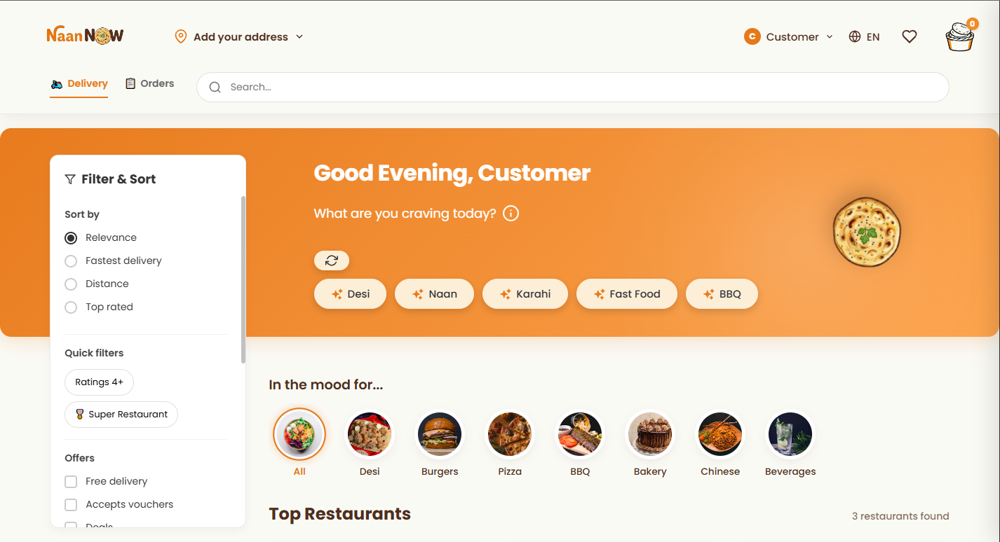
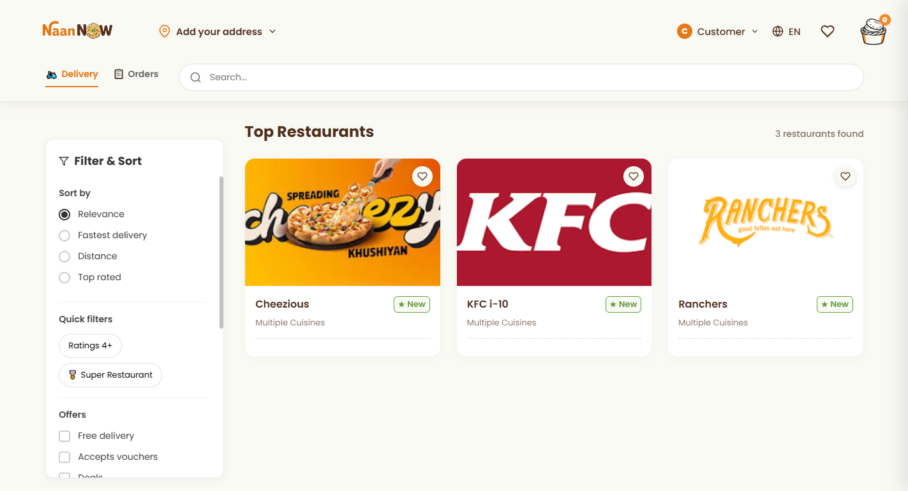
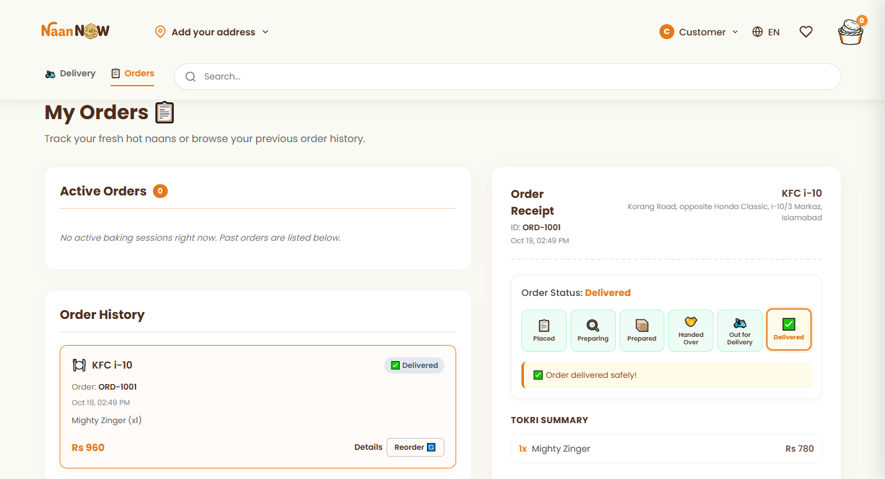
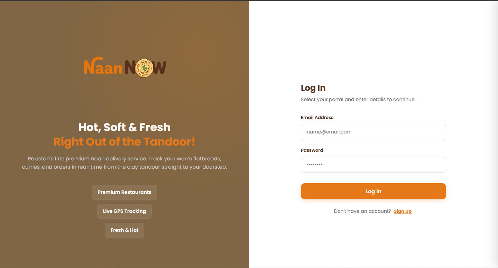
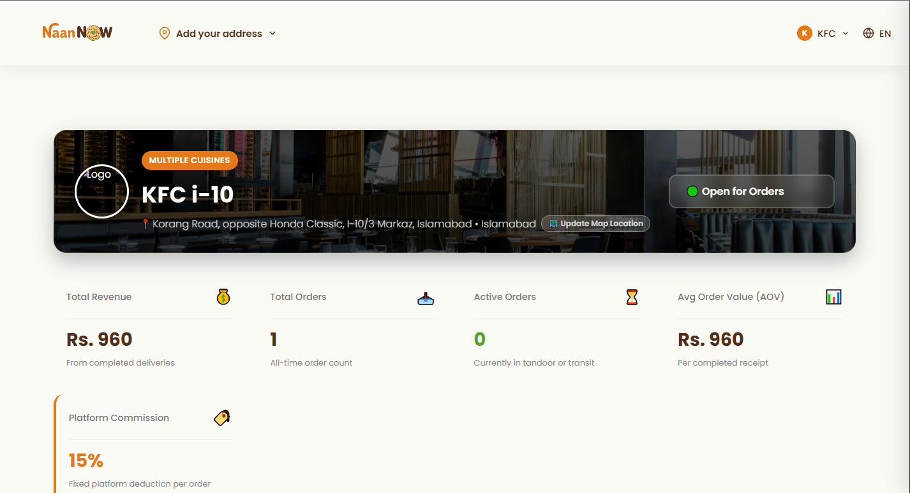
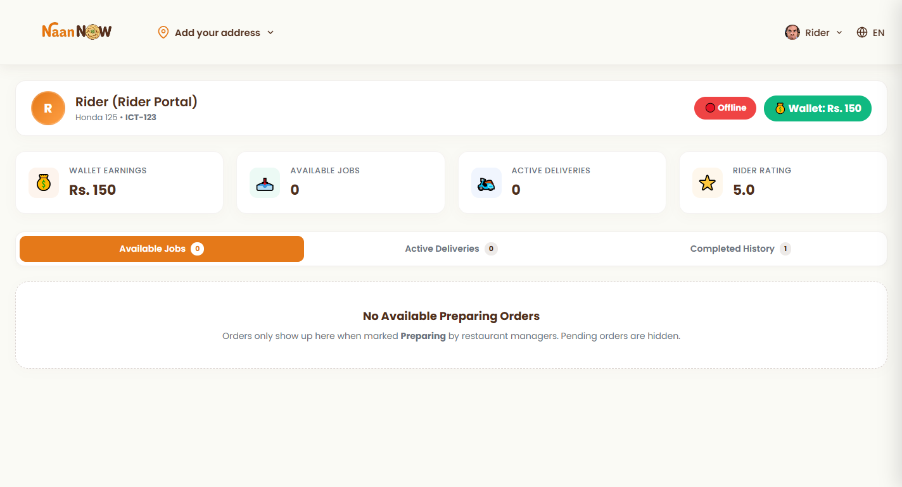
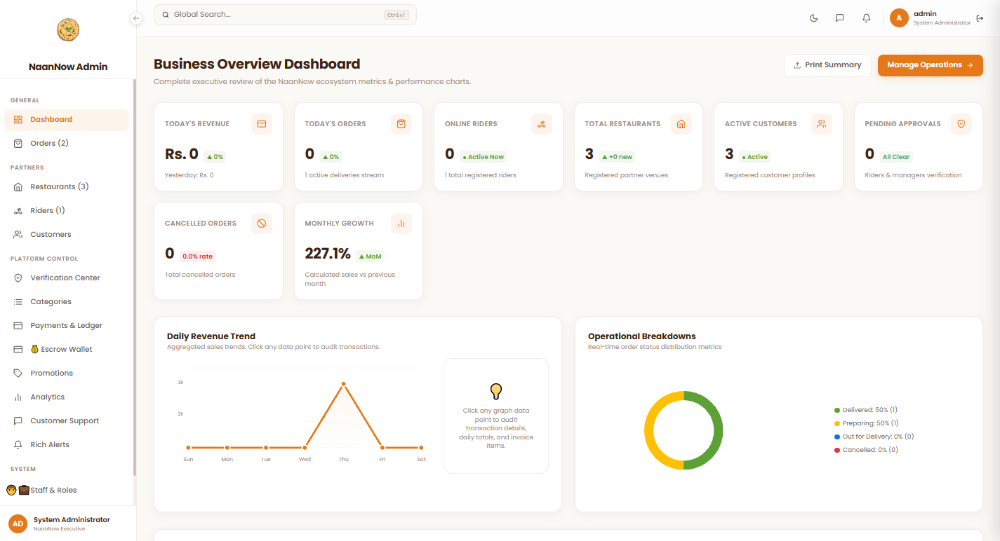
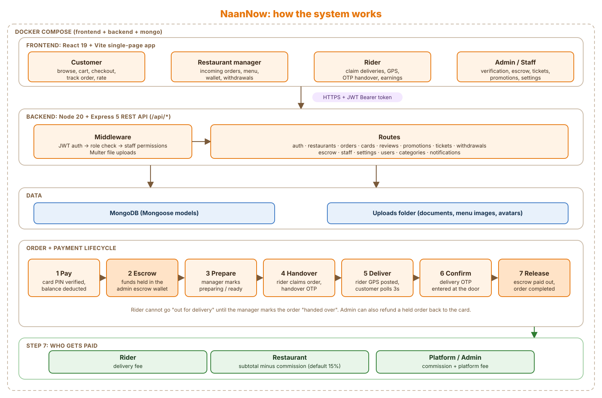

<div align="center">


# NaanNow

**A full-stack, multi-role food delivery platform: customers, restaurants, riders and admins in one system.**

</div>

---

> **Portfolio project.** NaanNow is a demo built to showcase end-to-end web development. No real food is delivered and every payment is **simulated**. Please don't enter real card, personal or CNIC details on the live site.

## Screenshots

### Customer experience

<p align="center">
  
  
</p>
<p align="center">
  
  
</p>

### Restaurant dashboard

<p align="center">
  
</p>

### Rider dashboard

<p align="center">
  
</p>

### Admin dashboard

<p align="center">
  
</p>

## Key Highlights

| | Highlight | What it does |
| --- | --- | --- |
| 🔐 | **Multi-role authentication and authorization** | JWT auth with four roles (customer, restaurant manager, rider, admin). Routes are protected on both the React frontend and the Express API, and riders and managers go through an admin approval flow before they can operate. |
| 📍 | **Live order tracking** | The rider's device streams GPS location to the API, and the customer's tracking page refreshes it every few seconds. An in-order chat connects rider and customer. |
| 🔑 | **OTP-based delivery verification** | A handover OTP confirms the pickup at the restaurant, and a customer OTP confirms the drop-off at the door. Orders can't skip steps: a rider can't mark an order out for delivery before the restaurant hands it over. |
| 💰 | **Escrow-based payment simulation** | Card payments are held in an admin escrow wallet, then split on completion between the rider (delivery fee), the restaurant (subtotal minus commission) and the platform. Admins can also release or refund held orders manually. |
| 🛡️ | **Granular staff permissions** | Admins create custom staff roles from 15 permissions (orders, riders, payments, escrow wallet, settings and more) and assign them to team members, with an assignment history. |
| 🐳 | **Dockerized deployment** | A single `docker compose up` starts the frontend, API and a MongoDB pre-loaded with demo data. A separate production setup serves the built frontend through Nginx. |

## System Architecture

<p align="center">
  
</p>

## Table of Contents

- [Screenshots](#screenshots)
- [Key Highlights](#key-highlights)
- [System Architecture](#system-architecture)
- [Overview](#overview)
- [Live Demo](#live-demo)
- [Features](#features)
- [How an Order Works](#how-an-order-works)
- [Tech Stack](#tech-stack)
- [Project Structure](#project-structure)
- [Getting Started](#getting-started)
- [Environment Variables](#environment-variables)
- [API Reference](#api-reference)
- [Data Models](#data-models)
- [Deployment](#deployment)
- [Contributors](#contributors)

## Overview

NaanNow models the full lifecycle of a food delivery marketplace. A customer browses restaurants and pays by (simulated) card, the money is held in an **admin escrow wallet**, the restaurant prepares the order, a rider picks it up and delivers it, and the funds are split between rider, restaurant and platform once delivery is confirmed.

The app has four primary roles, plus a configurable **staff** system that lets admins delegate parts of the admin panel with granular permissions.

## Live Demo

**https://naannow.ksdev.me/**

A welcome popup on the site lists ready-made demo accounts so you can explore every role without signing up:

| Role | Email | Password |
| --- | --- | --- |
| Customer | `customer@customer.com` | `customer` |
| Rider | `rider@rider.com` | `rider` |
| Admin | `admin@admin.com` | `admin` |
| Approval Staff | `approvalstaff@staff.com` | `approvalstaff_staff` |
| Restaurant (Cheezious) | `cheezious@restaurant.com` | `cheezious` |
| Restaurant (Ranchers) | `ranchers@restaurant.com` | `ranchers` |
| Restaurant (KFC) | `kfci10@restaurant.com` | `kfc` |

These accounts come from the bundled database backup. Data on the demo site may be reset at any time.

## Features

### Customer
- Browse restaurants by cuisine, with search and a filter sidebar
- Restaurant pages with full menus; persistent cart and favourites
- Checkout with saved cards (4-digit PIN verification, balance top-up), standard or priority delivery, delivery instructions and promo codes
- Live order tracking with rider location, in-order chat with the rider, and OTP-based delivery confirmation
- Rate the rider, the restaurant and individual items after delivery
- Order history, profile management and a support-ticket system with attachments

### Restaurant manager
- Onboarding with document upload (certificates, licence, NTN, photos) and admin verification
- Dashboard to manage incoming orders (preparing, ready for pickup, handed over)
- Menu management: add, edit and delete items with image upload
- Open/closed toggle and location updates
- Wallet and withdrawal requests

### Rider
- Onboarding with CNIC, licence and bike details, verified by an admin
- Online/offline toggle and a pool of orders ready to be claimed
- Live location updates streamed to the customer
- OTP handover at the restaurant and OTP confirmation at the customer's door
- Earnings wallet and withdrawals

### Admin and staff
- Dashboard over users, restaurants, riders, customers and all orders
- Verification queue: approve, reject, block or revoke riders and managers
- **Escrow wallet:** view held funds, manually release or refund an order
- Promotions (percentage or flat, minimum basket, max discount), food categories and platform settings (commission, delivery charges, taxes, maintenance mode)
- Support tickets with chat, assignment, status and unban-appeal controls
- Broadcast notifications and withdrawal approvals
- **Staff roles:** create custom roles from 15 permissions (orders, riders, payments, escrow wallet, settings, and so on) and assign them to team members, with an audit history

### Platform
- JWT authentication with role-based route protection on both frontend and backend
- Blocked-account flow with an appeal ticket
- Installable web app (manifest and generated icon set)
- One-command Docker setup with a pre-seeded database

## How an Order Works

```
Customer pays by card ──► funds move into the platform ESCROW
        │
        ▼
   pending ─► preparing ─► ready_for_pickup ─► handed_over ─► out_for_delivery ─► delivered ─► completed
                                                    ▲                                  ▲            │
                                          handover OTP (restaurant)        delivery OTP (customer)    │
                                                                                                      ▼
                                                              Escrow released: rider (delivery fee)
                                                                               restaurant (subtotal minus commission)
                                                                               platform (commission + platform fee)
```

- A rider can only mark an order **out for delivery** after the manager has marked it **handed over**.
- Admins can **refund** a held order back to the customer's card instead of releasing it.
- The platform commission is configurable (seeded at 15%).

## Tech Stack

| Layer | Technology |
| --- | --- |
| Frontend | React 19, Vite 8, React Router 7, react-icons, plain CSS |
| Backend | Node.js 20, Express 5, Mongoose 9 |
| Database | MongoDB (8.2 image, restored from a bundled backup) |
| Auth | JSON Web Tokens, bcryptjs |
| Uploads | Multer (profile pictures, verification documents, menu images, ticket attachments) |
| DevOps | Docker, Docker Compose, Nginx (production frontend), ESLint |

## Project Structure

```
NaanNow/
├── backend/
│   ├── middleware/        # auth (JWT + role/staff checks), upload, ticketUpload
│   ├── models/            # Mongoose schemas (User, Order, Restaurant, Card, Ticket, ...)
│   ├── routes/            # Express routers, one per resource
│   ├── uploads/           # Uploaded files, served at /uploads
│   ├── seed.js            # Idempotent demo-data seeder
│   └── server.js          # App entry point
├── frontend/
│   ├── public/            # Favicons, manifest, icons
│   ├── scripts/           # Icon generation script
│   └── src/
│       ├── components/    # Navbar, cart sidebar, filters, hero banner, ...
│       ├── context/       # AuthContext
│       ├── pages/         # Home, Restaurant, Checkout, Orders, Track Order, dashboards, ...
│       ├── config.js      # API URL resolution
│       └── App.jsx        # Routes and layout
├── Database_backup/       # Mongo image + gzip archive restored on first start
├── Docker file (deployment)/  # Production compose, Dockerfiles and .env example
├── docker-compose.yml     # Local development stack (hot reload)
└── All routes.docx        # Route documentation
```

## Getting Started

### Option 1: Docker (recommended)

**Prerequisites:** [Docker](https://docs.docker.com/get-docker/) with Compose.

```bash
# 1. Clone
git clone https://github.com/Khizar515/NaanNow.git
cd NaanNow

# 2. Create the root .env (see Environment Variables below)
cp "Docker file (deployment)/.env-example" .env
#    then edit .env: set JWT_SECRET / SESSION_SECRET and switch to the local URLs

# 3. Start everything
docker compose up --build
```

| Service | URL |
| --- | --- |
| Frontend (Vite dev server) | http://localhost:3001 |
| Backend API | http://localhost:5000 |
| MongoDB | `mongodb://localhost:27017/naannow` |

On first start, MongoDB restores the demo database from `Database_backup/naannow-data.archive.gz`, so the demo accounts listed above work immediately. To reset to a clean database, run `docker compose down -v` and start again.

To seed the demo data from `backend/seed.js` instead (it only inserts records that do not already exist):

```bash
docker compose exec backend node seed.js
```

### Option 2: Run manually

**Prerequisites:** Node.js 20+, a running MongoDB instance.

```bash
# Backend
cd backend
npm install
npm run dev            # starts on http://localhost:5000

# Frontend (new terminal)
cd frontend
npm install
npm run dev            # starts on http://localhost:5173
```

Both apps read the `.env` file in the **project root** (one level above `backend/` and `frontend/`). For a manual run, point `MONGODB_URI` at your own MongoDB, for example `mongodb://localhost:27017/naannow`.

To load the bundled backup into a local MongoDB:

```bash
mongorestore --gzip --archive=Database_backup/naannow-data.archive.gz --nsInclude="naannow.*"
```

### Frontend scripts

```bash
npm run dev       # start the Vite dev server
npm run build     # production build to dist/
npm run preview   # preview the production build
npm run lint      # run ESLint
```

## Environment Variables

Create a `.env` file in the project root:

```env
PORT=5000
MONGODB_URI=mongodb://mongo:27017/naannow   # use localhost instead of mongo outside Docker

# Generate secrets with: openssl rand -hex 32
JWT_SECRET=change-me
SESSION_SECRET=change-me

# Backend base URL used by the frontend (Vite)
VITE_API_BASE_URL=http://localhost:5000

# Frontend URL used by backend CORS
FRONTEND_URL=http://localhost:3001
```

| Variable | Description |
| --- | --- |
| `PORT` | Port the API listens on (default `5000`) |
| `MONGODB_URI` | MongoDB connection string (default `mongodb://mongo:27017/naannow`) |
| `JWT_SECRET` | Secret used to sign and verify auth tokens |
| `SESSION_SECRET` | Session secret |
| `VITE_API_BASE_URL` | API origin the React app calls |
| `FRONTEND_URL` | Frontend origin added to the CORS allow-list |

> Never commit your real `.env`. It is already in `.gitignore`.

## API Reference

All routes are prefixed with `/api`. Protected routes expect an `Authorization: Bearer <token>` header. `GET /` returns a health check including the MongoDB connection status.

| Resource | Base path | Highlights |
| --- | --- | --- |
| Auth | `/api/auth` | `POST /register`, `POST /login`, `GET /me`, `PUT /profile`, `PUT /password`, `POST /upload-avatar` |
| Restaurants | `/api/restaurants` | List and detail (public), manager's own restaurant, open/closed toggle, location, menu item CRUD with image upload |
| Orders | `/api/orders` | Create, role-aware listing, status updates, rider assignment, handover and delivery OTP verification, rider location, rating, order chat |
| Cards | `/api/cards` | List, add, top up, delete saved cards |
| Reviews | `/api/reviews` | Create review, fetch reviews for an order |
| Promotions | `/api/promotions` | Admin CRUD and toggle, `POST /validate` for customers |
| Categories | `/api/categories` | Public list, admin create/update/delete |
| Tickets | `/api/tickets` | Create with attachments, reply, close, status, assignment, unban status |
| Notifications | `/api/notifications` | Admin broadcast, `GET /my` for the current user |
| Withdrawals | `/api/withdrawals` | Request payout, list own, admin approve/reject |
| Users | `/api/users` | Admin user management (status, reject, revoke), rider online toggle, document upload, withdraw |
| Settings | `/api/settings` | Public read, admin update (commission, delivery charges, taxes, maintenance mode) |
| Staff | `/api/staff` | Roles, members and assignment history |
| Escrow | `/api/escrow` | View held funds, `POST /release/:orderId`, `POST /refund/:orderId` |

Full route documentation is available in [`All routes.docx`](All%20routes.docx).

## Data Models

`User` (customer, manager, rider, admin) · `Restaurant` (with embedded menu) · `Order` (items, OTPs, rider location, chat, ratings) · `Card` · `Review` · `Ticket` · `Notification` · `Promotion` · `Withdrawal` · `Category` · `PlatformSettings` · `StaffRole` · `StaffAssignment`

## Deployment

The `Docker file (deployment)/` folder contains a production setup:

- **Backend:** Node 20 Alpine image running the API
- **Frontend:** multi-stage build that compiles the Vite app and serves it with **Nginx** (container port 80, mapped to 3000)
- **MongoDB:** named volume so data survives restarts

The live site runs the frontend at `naannow.ksdev.me` and the API at `naannow-api.ksdev.me`. The frontend automatically resolves the API origin from `VITE_API_BASE_URL`, falling back to a `-api` sibling of the current hostname when deployed.

## Contributors

NaanNow was built as a joint project.

| Contributor | GitHub |
| --- | --- |
| Khizar Nadeem | [@Khizar515](https://github.com/Khizar515) |
| Muhammad Saad | [@SaadLabs](https://github.com/SaadLabs) |

If you found this project interesting, consider giving it a star.
